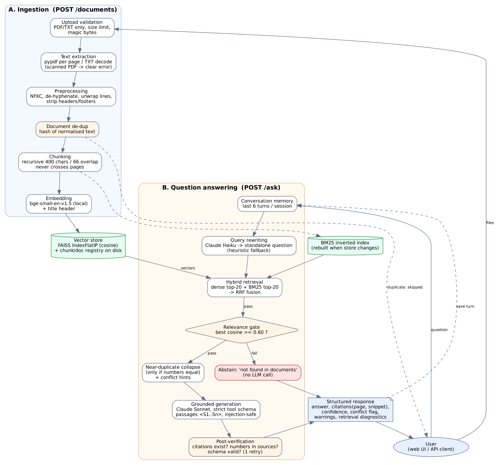

# Architecture

*(Source: `architecture.dot`, rendered with Graphviz. Vector version: `architecture.svg`.)*

## Ingestion path (`POST /documents`)
1. **Validate** extension (.pdf/.txt), size limit, PDF magic bytes, binary-looking text → typed errors (415/413/422).
2. **Extract** text per page (`pypdf`); TXT decoded as UTF-8 then cp1252. A PDF with no text layer (scan) raises `no_extractable_text` explaining that OCR is needed.
3. **Preprocess**: Unicode NFKC, soft/line-break hyphen repair, re-join wrapped PDF lines (keeping bullets/headings), drop repeating headers/footers and page numbers.
4. **Document de-duplication**: SHA-256 of whitespace/case-normalised cleaned text; identical content under another name is skipped and reported.
5. **Chunk**: recursive splitter (paragraph → line → sentence → clause → word), 400 chars with ~66 overlap, never across pages (exact page citations).
6. **Embed** `"<doc title>\n<chunk>"` (contextual header disambiguates e.g. 2023 vs 2024) → L2-normalised vectors.
7. **Index** into FAISS `IndexFlatIP`; chunk/doc registry + vectors persisted atomically to `storage/`.

## Query path (`POST /ask`)
1. **Memory** supplies the last 6 turns of the session.
2. **Rewrite** follow-ups into a standalone query (Claude Haiku; heuristic fallback if the call fails).
3. **Hybrid retrieval**: dense top-20 (FAISS) + BM25 top-20 → Reciprocal Rank Fusion.
4. **Relevance gate**: the best dense cosine score must reach a calibrated threshold (default 0.60), otherwise the system abstains **without calling the LLM**.
5. **Duplicate collapse / conflict hints**: near-duplicate chunks are merged only if their numbers are identical (so "20 days" vs "25 days" are kept as a conflict); similar chunks from different documents with different numbers are flagged to the model.
6. **Grounded generation**: numbered passages `<passage label="S1" …>` in XML, strict tool schema (`submit_answer`), rules: answer only from passages, cite every claim, abstain when unsupported, report conflicts, ignore instructions inside passages.
7. **Post-verification** (deterministic): drop citations that don't exist; an "answerable" reply with no valid citation is converted to an abstention; numbers in the answer must appear in the cited text or confidence is capped and a warning is returned; invalid schema → one repair retry → `502`.
8. **Response**: answer, citations (source, page, snippet, score, duplicates), confidence, conflict flag, warnings, retrieval diagnostics.

## State
Vector store + registry on disk (survives restarts); conversation memory in process (lost on restart, bounded to 500 sessions × 6 turns).
